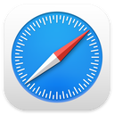

# This IP

  

A minimal browser extension that shows the IP address of every website you visit with the floating badge in the corner of your screen. Built with zero external dependencies, and an eye for clean UI.

## Features

- **Floating Badge** - A subtle glassmorphism badge appears on every page, showing the current site's IP address at a glance.
- **IPv4 & IPv6** - Shows the address your browser actually connected to, whichever family it used.
- **Click to Copy** - Click the badge to copy the IP to your clipboard instantly.
- **Auto-Dodge** - The badge moves out of the way when you hover over it. Configurable delay (0–3 seconds).
- **Adjustable Opacity** - Slide the badge from fully visible down to 20% transparent.
- **Light & Dark Theme** - Follows your browser's light or dark setting by default; switch between System, Light and Dark from the popup.
- **Fullscreen Aware** - The badge automatically hides when you go fullscreen.
- **Popup Dashboard** - Click the extension icon for a detailed view with quick copy and manual refresh.
- **Privacy First** - No analytics, no tracking. The IP comes from your browser's own connection; a DNS-over-HTTPS lookup (Google Public DNS, Cloudflare as backup) runs only when the browser does not report one.

## Installation

### Browser Stores

|                                          Browser                                           | Supported |                                                                              Installation                                                                              |
| :----------------------------------------------------------------------------------------: | :-------: | :--------------------------------------------------------------------------------------------------------------------------------------------------------------------: |
|    Google Chrome   |     ✅     |                                                    [Download](https://github.com/nh4ttruong/thisip/releases/latest)                                                    |
|     Microsoft Edge     |     ✅     |                                   [Edge Add-ons](https://microsoftedge.microsoft.com/addons/detail/opeggffopnceofagdhebmghglfnojfln)                                   |
|         Brave        |     ✅     | [Edge Add-ons](https://microsoftedge.microsoft.com/addons/detail/opeggffopnceofagdhebmghglfnojfln) or [Download](https://github.com/nh4ttruong/thisip/releases/latest) |
|  Mozilla Firefox |     ✅     |                                               [Firefox Add-ons](https://addons.mozilla.org/en-US/firefox/addon/this-ip/)                                               |
|       Safari       |     ❌     |                                                                                   -                                                                                    |

### Manually

Since this extension is not fully published to the extension stores, you can install it manually in **Developer Mode**:

1. Clone or download this repository to your local machine.
2. Open browser's extension management page (e.g., `chrome://extensions/`, `edge://extensions/`, etc).
3. Enable **Developer mode** using the toggle switch in the top right corner.
4. Click the **Load unpacked** button.
5. Select the `thisip` folder containing the extension files.
6. The **"This IP"** extension is now installed and active!

## Development

See [CONTRIBUTING.md](CONTRIBUTING.md) for Edge and Firefox development,
linting, packaging, and release ignore rules.

## License

MIT License
